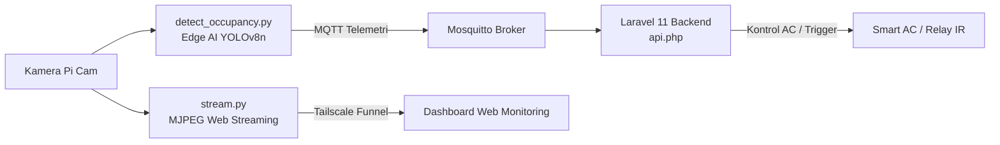

# Prototipe Sistem Kendali AC Cerdas Berbasis Deteksi Okupansi YOLOv8n

Repositori ini memuat kode sumber inti (*core source code*) yang digunakan pada penelitian tugas akhir / capstone:

> **"Analisis Performa YOLOv8n dalam Mendeteksi Jumlah Orang untuk Trigger Kendali AC Jarak Jauh"**  
> **Penulis:** Mirza Putra Firmansyah  
> **Institusi:** Program Studi Teknik Informatika, Universitas Negeri Semarang (UNNES)

---

## 📌 Ringkasan Sistem

Sistem ini mengintegrasikan pemrosesan *computer vision* di sisi *edge* (*Raspberry Pi 5*) untuk mendeteksi keberadaan dan jumlah orang di dalam ruangan secara *real-time* menggunakan model ringan **YOLOv8n (YOLOv8 nano)**. Hasil deteksi (okupansi) dikirimkan melalui protokol komunikasi ringan **MQTT** ke backend server **Laravel 11**, yang mengevaluasi aturan kendali (*rule engine*) dan mengirimkan *trigger command* ke unit pendingin ruangan (AC) untuk efisiensi energi.



---

## 📂 Struktur Berkas Lampiran

| Nama Berkas | Komponen / Platform | Deskripsi Singkat |
| :--- | :--- | :--- |
| [`detect_occupancy.py`](detect_occupancy.py) | Edge Device (Raspberry Pi 5) | Skrip inferensi utama menggunakan YOLOv8n, multithreading video capture, deteksi kepala/orang, penghitungan FPS, dan pengiriman telemetri okupansi via MQTT. |
| [`stream.py`](stream.py) | Edge Streaming (Raspberry Pi 5) | Server streaming video lokal berbasis Flask HTTP MJPEG stream dengan konfigurasi rotasi frame dan eksposur via Tailscale Funnel. |
| [`api.php`](api.php) | Backend Server (Laravel 11) | Definisi rute REST API lengkap untuk mengelola telemetri okupansi, status perangkat edge, konfigurasi aturan suhu, dan *trigger* kendali AC. |

---

## ⚙️ Spesifikasi & Kebutuhan Sistem

### 1. Perangkat Keras (*Hardware*)
- **Unit Komputasi:** Raspberry Pi 5 (8 GB RAM)
- **Sensor Visual:** Raspberry Pi Camera Module 3 / USB Camera (1920x1080 @ 30 FPS)
- **Aktuator:** Mikrokontroler NodeMCU ESP8266 / ESP32 dengan IR Transmitter & Sensor DHT22

### 2. Perangkat Lunak (*Software Environment*)
- **OS Edge:** Raspberry Pi OS 64-bit (Debian Bookworm)
- **Runtime:** Python 3.11+, PHP 8.2+, Composer
- **Library Python Edge:**
  - `ultralytics` (YOLOv8)
  - `opencv-python` (`cv2`)
  - `paho-mqtt`
  - `flask`
- **Jaringan & Komunikasi:**
  - Mosquitto MQTT Broker
  - Tailscale VPN & Tailscale Funnel (untuk akses remote aman tanpa port forwarding publik)

---

## 🚀 Panduan Eksekusi

### 1. Menjalankan Video Streaming MJPEG
```bash
python3 stream.py
# Streaming dapat diakses secara lokal pada http://localhost:5000/video_feed
# Atau melalui domain Tailscale Funnel yang telah dikonfigurasi
```

### 2. Menjalankan Inferensi Deteksi Okupansi YOLOv8n
```bash
python3 detect_occupancy.py
# Skrip akan membuka stream kamera, memuat weights/model YOLOv8n,
# melakukan inferensi deteksi kepala manusia, dan mempublikasikan data okupansi ke MQTT broker.
```

### 3. Konfigurasi Backend Laravel
Pastikan berkas `api.php` telah terpasang pada direktori `routes/api.php` di proyek backend Laravel 11. Jalankan server:
```bash
php artisan serve
```

---

## 📄 Lisensi & Hak Cipta
Kode ini dikembangkan khusus untuk keperluan penelitian akademik dan skripsi/capstone di Universitas Negeri Semarang. Bebas digunakan dan dikembangkan untuk keperluan akademik dengan mencantumkan sitasi atau atribusi kepada penulis.
